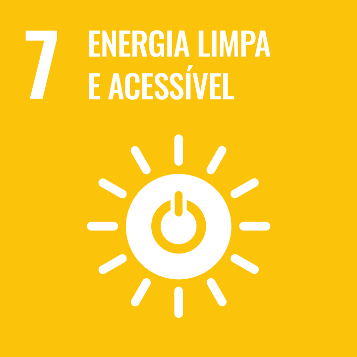
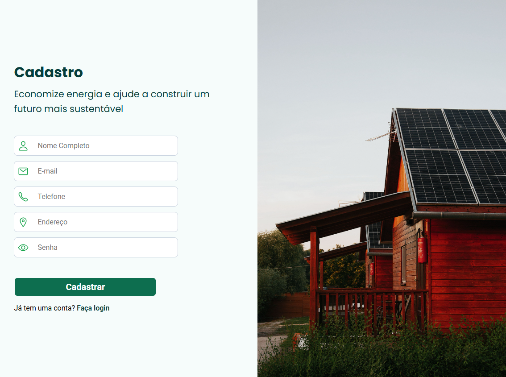
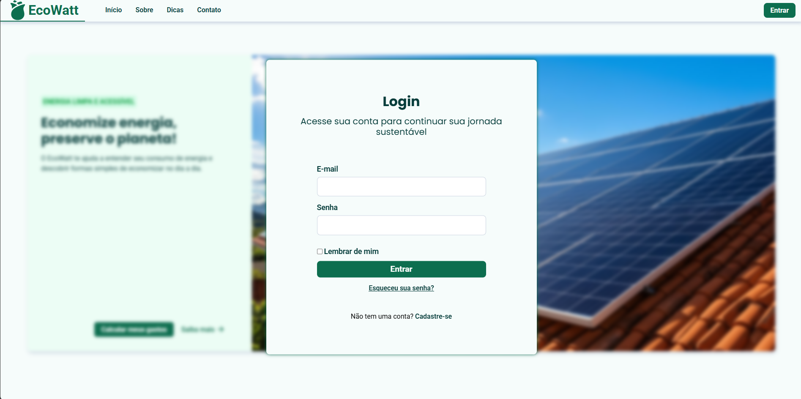
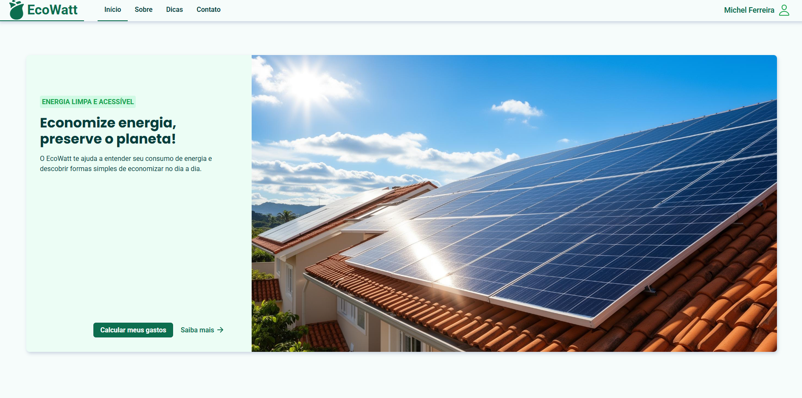
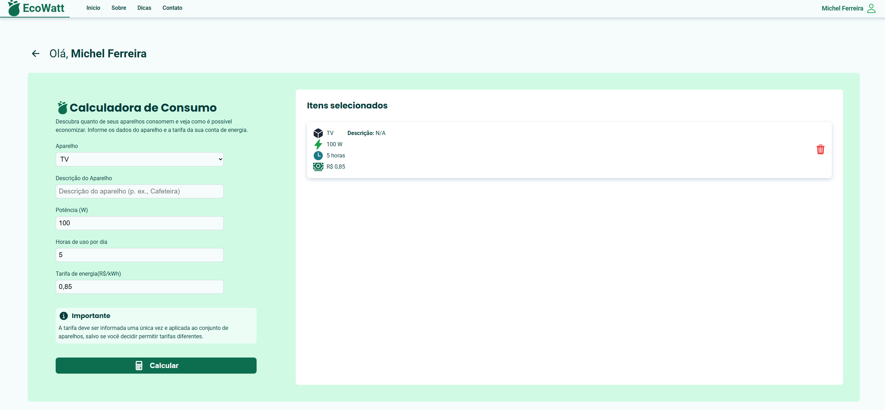
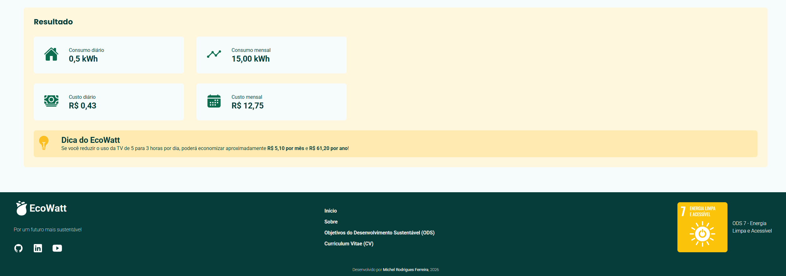

# EcoWatt

## Contexto acadêmico

O EcoWatt foi desenvolvido como parte do Projeto Prático da disciplina **Programação Web Front-end**, do curso de **Bacharelado em Engenharia de Software** da **Universidade Tecnológica Federal do Paraná (UTFPR)**, campus de Cornélio Procópio-PR.

O projeto tem como finalidade aplicar os conhecimentos adquiridos durante a disciplina no desenvolvimento de uma aplicação web, utilizando apenas HTML e CSS para construir uma interface estruturada, acessível e visualmente organizada.

A proposta também busca relacionar os conhecimentos técnicos da área de desenvolvimento web a uma necessidade socioambiental, por meio de uma solução alinhada aos Objetivos de Desenvolvimento Sustentável (ODS) da Organização das Nações Unidas (ONU). A escolha do ODS foi de liberdade do discente.

## Objetivo do projeto

O EcoWatt é uma plataforma web desenvolvida com o objetivo de facilitar a compreensão do consumo de energia elétrica, ajudando os usuários a identificar oportunidades de economia e adotar hábitos mais eficientes no dia a dia.

Por meio de uma calculadora de consumo, estimativas de gastos e conteúdos educativos, o projeto busca transformar informações sobre energia elétrica em conhecimento acessível e útil para a tomada de decisões conscientes.

Dessa forma, o EcoWatt contribui para o Objetivo de Desenvolvimento Sustentável (ODS) número 7 da Organização das Nações Unidas (ONU).

_ODS 7 — Energia limpa e acessível_

## Funcionalidades

- **Calculadora de consumo elétrico:** estima o consumo de energia dos aparelhos com base em sua potência e no tempo de utilização.
- **Estimativa de gastos:** calcula o custo aproximado do consumo a partir da tarifa de energia elétrica informada pelo usuário.
- **Simulação de economia:** permite comparar diferentes tempos de utilização para compreender como mudanças na rotina podem afetar o consumo e os custos estimados.
- **Conteúdos educativos:** reúne orientações e dicas para incentivar o consumo consciente de energia elétrica.
- **Painel do usuário:** centraliza o acesso às funcionalidades da plataforma.
- **Página institucional:** apresenta a proposta, os objetivos e o compromisso socioambiental do EcoWatt.

## Alinhamento com a ODS 7

O EcoWatt está alinhado ao **Objetivo de Desenvolvimento Sustentável 7 (ODS 7) — Energia Limpa e Acessível**, estabelecido pela Organização das Nações Unidas (ONU).

A iniciativa busca contribuir para a conscientização sobre eficiência energética e consumo responsável, promovendo o acesso à informação como ferramenta para decisões mais sustentáveis.

Saiba mais sobre os Objetivos de Desenvolvimento Sustentável: [ONU Brasil — ODS](https://brasil.un.org/pt-br/sdgs).

## Tecnologias utilizadas

O projeto utiliza tecnologias fundamentais para o desenvolvimento de interfaces web:

- **HTML5:** estruturação das páginas e organização do conteúdo.
- **CSS3:** estilização, identidade visual, layouts e componentes da interface.
- **SVG:** utilização de ícones e elementos gráficos vetoriais.
- **Google Fonts:** utilização das famílias tipográficas Poppins e Roboto.

## Fluxo da aplicação

Como o projeto utiliza HTML e CSS, foram feitas adaptações para atender aos requisitos da atividade. O fluxo de navegação da aplicação segue a ordem descrita abaixo.

### 1. Página de cadastro

Representada pelo arquivo `index.html`.

### 2. Página de login

Após o cadastro, realizado de forma simulada, o usuário é direcionado à página de login, representada pelo arquivo `login.html`.

### 3. Página principal

Após o login, o usuário é direcionado à página principal, que consiste em um portal que dá acesso a informações sobre o EcoWatt, dicas sobre consumo consciente de energia e redução de gastos, além de uma calculadora destinada a esclarecer os gastos energéticos domiciliares do usuário e fornecer dicas de economia e sustentabilidade.

### 4. Calculadora de consumo energético

Na calculadora, o usuário deve preencher os campos de entrada (_inputs_) e solicitar o cálculo. Esse evento de cálculo não ocorre nesta aplicação, haja vista que a ferramenta não foi estruturada com código lógico, como JavaScript ou outras tecnologias.

Por esse motivo, a calculadora demonstra apenas o comportamento visual previsto para uma aplicação mais complexa no futuro.

## Desenvolvedor

**Michel R. Ferreira**

- [GitHub](https://github.com/monwire)
- [LinkedIn](https://www.linkedin.com/in/michel-rodrigues-ferreira-ab06b2360/)
- [Curriculum Vitae](https://monwire.github.io/curriculum-vitae/)
